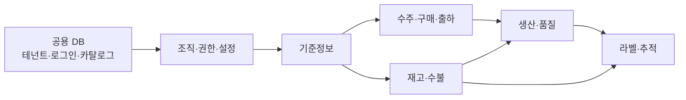
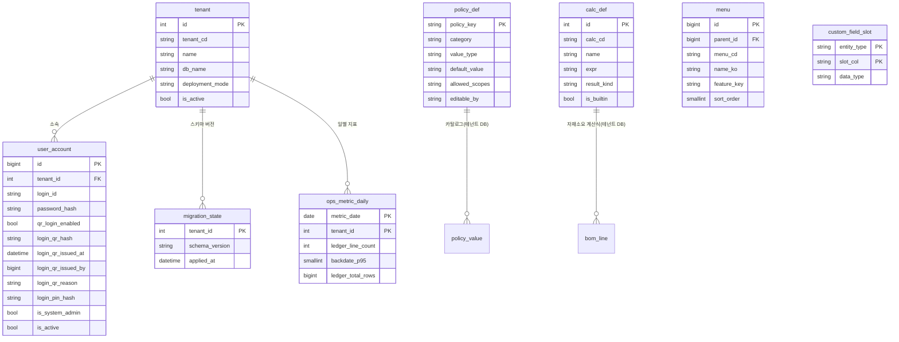
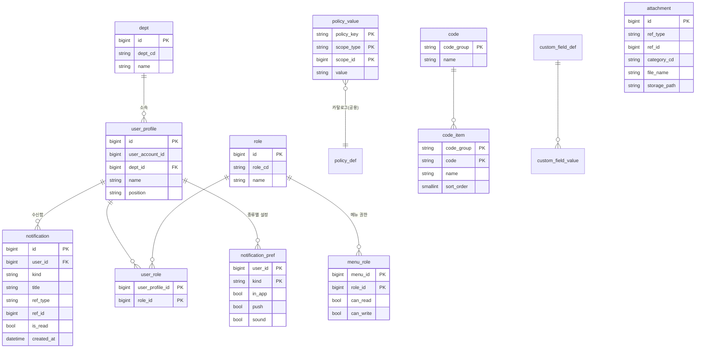
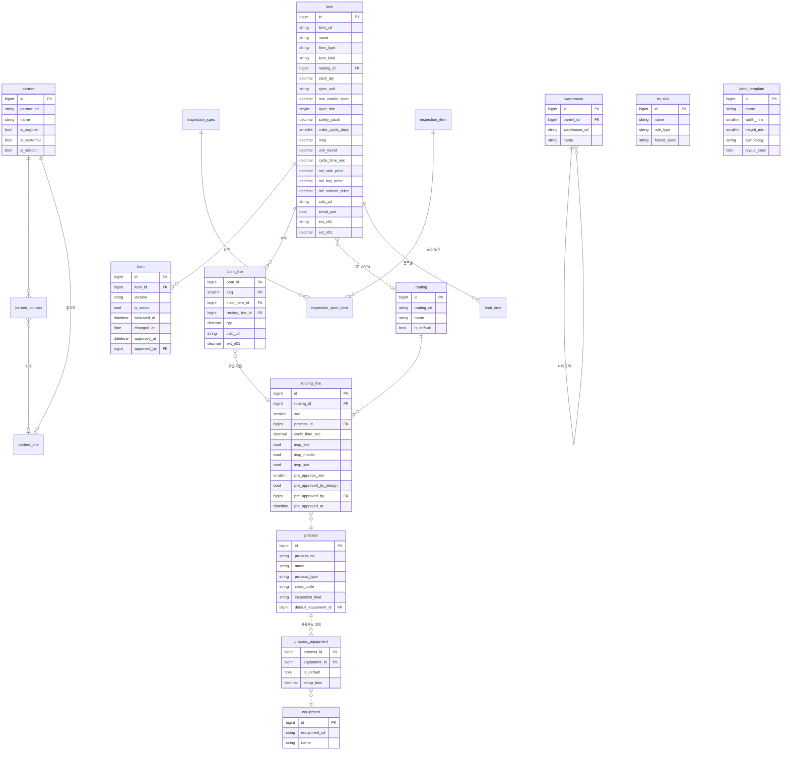
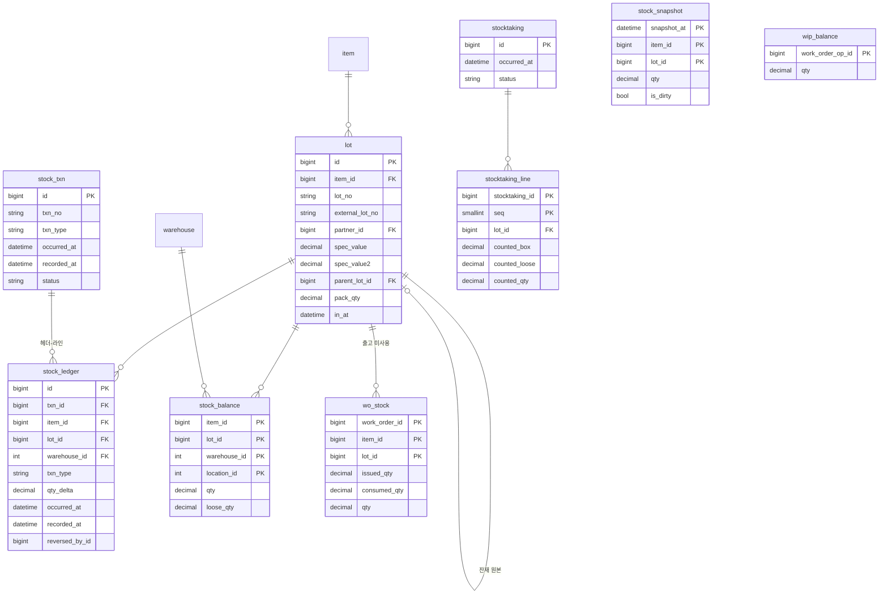
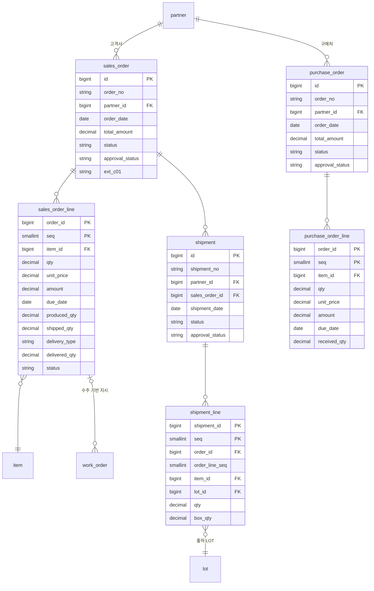
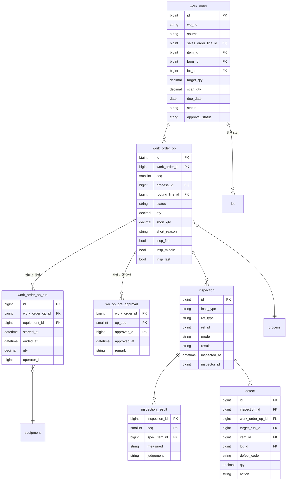
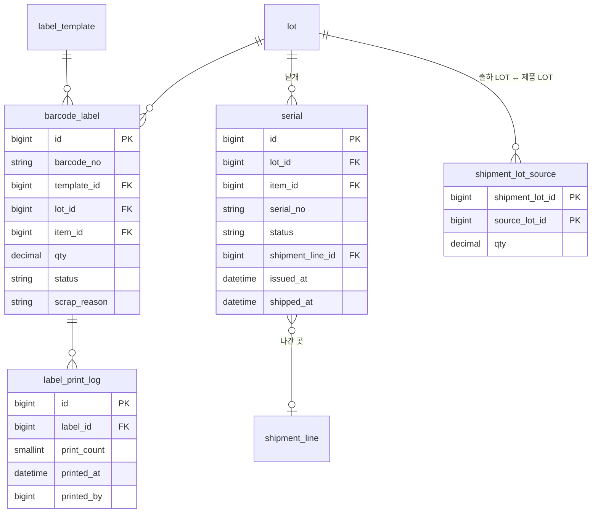

# Phase 1 ERD

> mes-v6 · MVP 범위 데이터 모델
> 작성일: 2026-08-28 · 상태: 초안
> 상위 문서: [개발범위-및-MVP.md](./개발범위-및-MVP.md)
>
> 상세 DDL이 이미 있는 도메인은 각 설계 문서를 따릅니다 —
> [멀티테넌시](./멀티테넌시-설계.md) · [재고-수불](./재고-수불-설계.md) · [정책-설정](./정책-설정-설계.md) ·
> [커스텀-컬럼](./커스텀-컬럼-설계.md) · [전자결재](./전자결재-설계.md) · [정기수주](./정기수주-설계.md)

---

## 1. 범위

**Phase 0 + Phase 1**에 필요한 테이블만 담습니다.
Phase 2 이후 테이블은 **자리만 표시**하고 컬럼을 정의하지 않습니다
([개발범위-및-MVP.md](./개발범위-및-MVP.md) §6 — *"빼되 설계는 미리"*).

DB는 둘로 나뉩니다 ([멀티테넌시-설계.md](./멀티테넌시-설계.md)).

| | 내용 |
|---|---|
| `mes_common` | 테넌트 · 로그인 · 정책 카탈로그 · 메뉴 구조 · 운영 지표 |
| `mes_t{id}` | 업무 데이터 전부 |

---

## 2. 공통 규칙

### 명명

| 대상 | 규칙 | 예 |
|---|---|---|
| 테이블 | 단수 `snake_case` | `sales_order` |
| PK | `id` (`BIGINT AUTO_INCREMENT`) | |
| FK | `{테이블}_id` | `item_id` |
| 사용자 코드 | `{}_cd` | `item_cd` · `partner_cd` |
| 플래그 | `is_` | `is_active` |
| 시각 | `_at` (`DATETIME(6)`) | `created_at` |
| 날짜 | `_date` (`DATE`) | `due_date` |
| 헤더-라인 | `{}` / `{}_line` | `sales_order` / `sales_order_line` |

### 공통 컬럼

모든 테넌트 테이블에 들어갑니다.

```sql
tenant_id   INT         NOT NULL          -- 오배치 탐지용 (멀티테넌시 §4)
created_at  DATETIME(6) NOT NULL
created_by  BIGINT      NOT NULL
updated_at  DATETIME(6) NULL
updated_by  BIGINT      NULL
```

마스터 테이블은 `is_active BOOLEAN NOT NULL DEFAULT TRUE`를 더합니다.
**마스터는 삭제하지 않습니다** — 과거 트랜잭션이 참조하고 있습니다.

### 금액 · 수량

| 용도 | 타입 |
|---|---|
| 수량 | `DECIMAL(18,6)` |
| 금액 | `DECIMAL(18,2)` |
| 규격값 | `DECIMAL(18,6)` |

---

## 3. 도메인 지도



---

## 4. 공용 DB — `mes_common`



`approval_form_def`도 공용이지만 **Phase 2**입니다.

---

## 5. 조직 · 권한 · 설정



- `user_account`(공용)는 **로그인**, `user_profile`(테넌트)은 **이름 · 부서 · 직급**입니다
- `qr_login_enabled` — **본인이 켠 사람만** QR을 발급받고 QR로 로그인합니다(기본 꺼짐). **끄면 기존 QR이 즉시 무효**입니다 — 전원 발급해 두면 안 쓰는 카드가 서랍에 방치되고 그게 유출 경로가 됩니다
- `login_qr_hash` — **현장 QR 로그인.** 장갑 낀 손으로 비밀번호를 치게 할 수 없습니다. **해시만 저장**하고 평문은 발급 시 한 번 인쇄하고 버립니다. 분실하면 **재인증(비밀번호 재입력) 후 재발급**하고 **이전 QR은 그 순간 무효**입니다. **관리자 계정은 QR 로그인 불가**이고, 공용 단말이라 **유휴 10분에 자동 로그아웃**합니다 ([프로그램-스펙 §7.1](./프로그램-스펙.md))
- `menu_role.can_read = false` 면 **그 역할 사용자 메뉴에서 사라집니다**
  ([정책-설정-설계.md](./정책-설정-설계.md) §7)
- `attachment.ref_type` + `ref_id`로 어떤 테이블에도 붙습니다. `category_cd`는 성적서 · 밀시트 · 도면
- `notification` — **알림의 진실은 이 행**입니다. 웹소켓은 전달 수단일 뿐이라 저장 없이 push하지 않습니다
- `ix_inbox (tenant_id, user_id, id)` — **재연결 복구용**. 끊긴 동안 쌓인 것을 `last_seen_id` 뒤부터 한 번에 내려보냅니다
- 채널은 `tenant:{id}:user:{id}` — **채널 이름에 테넌트를 박아** 코드가 실수해도 경계가 막습니다
  ([알림-설계.md](./알림-설계.md))

---

## 6. 기준정보



### 담당자 구분도 코드 마스터다

거래처 담당자는 **본사 · 출고지 · 영업 · 회계**처럼 **업체마다 다릅니다.**
고정 ENUM으로 잡으면 반드시 모자랍니다.

```
code_item  PARTNER_CONTACT_TYPE · HQ     · 본사
                                · SITE   · 출고지
                                · SALES  · 영업담당
                                · ACCT   · 회계담당
           …  업체가 SYS-06 에서 더합니다
```

**소속 출고지는 구분과 별개 컬럼입니다.**

| 컬럼 | 무엇 |
|---|---|
| `partner_contact.contact_type` | **무슨 역할인가** — 코드 마스터 |
| `partner_contact.site_id` | **어디 소속인가** — `partner_site` FK, **`NULL` 허용** |

*"1공장의 영업담당"* 같은 조합이 생깁니다. 한 축으로 묶으면 표현되지 않습니다.

### 검사 항목은 골라 쓰거나 새로 쓴다

**둘 다 됩니다.** 마스터에서 고르거나, 기준서에서 바로 입력하거나.

```
inspection_item (항목 마스터)
  외경        정량 · 캘리퍼 · mm
  길이        정량 · 캘리퍼 · mm
  외관        정성 · 육안 · "흠 · 이물 없음"

inspection_spec_item (기준서의 줄)
  master_id → 마스터에서 골랐으면 채워집니다. 직접 입력이면 NULL
```

#### 치수는 마스터에 담기지 않는다

**규격과 상 · 하한이 품목마다 다르기 때문입니다.**
외경 20.0 ± 0.1 은 그 품목의 것이지 "외경"이라는 항목의 것이 아닙니다.

| 항목 | 마스터가 주는 것 | 기준서에서 채우는 것 |
|---|---|---|
| **치수**(외경 · 길이) | 이름 · 방법 · 단위 | **규격 · 상한 · 하한 — 필수** |
| **외관 · 표면** | 이름 · 방법 · **판정 기준까지** | 그대로 씁니다 |

**외관 검사는 품목이 달라도 문구가 비슷합니다.** 거기서 마스터가 값을 합니다 —
치수는 이름만 빌려 오고 숫자는 매번 새로 넣습니다.

#### 고르는 순간 복사된다

`master_id`는 **어디서 왔는지 표시일 뿐, 값을 따라가지 않습니다.**

> **마스터를 고쳐도 기존 기준서는 바뀌지 않습니다.**
> BOM · 단가와 같은 원칙입니다 — 이미 검사한 이력이 나중에 뜻이 달라지면
> **과거 판정의 근거가 사라집니다.**

새 기준서부터 새 값이 붙습니다.

### 단위는 코드 마스터에서 고른다

`item.spec_unit`은 **자유 문자열이 아닙니다.** `code_item`의 `UNIT` 그룹을 참조합니다.

```
code       code_group = 'UNIT'   단위
code_item  UNIT · EA   · 개
           UNIT · BOX  · 박스
           UNIT · kg   · 킬로그램
           UNIT · mm   · 밀리미터
           …
```

**새 테이블을 만들지 않습니다.** 공통코드(`code` · `code_item`)가 이미 있고
`SYS-06 코드관리`가 그 화면입니다 — 단위는 **그중 한 그룹**일 뿐입니다.

#### 왜 자유 입력을 막는가

| 자유 입력이면 | |
|---|---|
| 표기가 갈립니다 | `EA` · `ea` · `개` · `EA.` 가 **서로 다른 단위**가 됩니다 |
| 집계가 깨집니다 | 재고 현황에서 같은 물건이 **두 줄로 나뉩니다** |
| 계산식이 헛돕니다 | `SPEC` · `CUT` 이 mm 인지 m 인지 **시스템이 모릅니다** |

**초기 데이터로 `EA` · `BOX` · `kg` · `g` · `mm` · `m` · `L` · `SET` 를 넣어 둡니다.**
업체가 더 필요하면 `SYS-06`에서 더합니다 — 코드 값은 **영문**으로 강제합니다.

> **단위별 소수 자릿수는 두지 않습니다.** `EA`에 3.5를 막는 검증이 필요해지면
> 그때 `code_item`을 오염시키는 대신 **전용 `unit` 테이블로 승격**합니다.
> 지금 붙이면 범용 코드 테이블에 단위 전용 컬럼이 생깁니다.

### 제품 구분

`item.item_kind`는 원문의 구분을 그대로 따릅니다.

| `item_type` | `item_kind` | 설명 |
|---|---|---|
| `MATERIAL` | `RAW` · `STOCK` | 원자재 · 원소재 |
| `PRODUCT` | `FINISHED` | 완제품 — **단독으로 팔리는 것** |
| `PRODUCT` | `SEMI` | 반제품 — **사내에서만 소비되는 것** |
| `PRODUCT` | **`SET`** | **미조립 세트** — 조립하지 않고 포장해 납품 |

#### 구분 기준은 "단독으로 파는가"

**BOM에서 하위에 있다고 반제품이 아닙니다.**

세트의 구성품은 **대부분 완제품**입니다 — 세트로도 팔고 **낱개로도 팝니다.**
BOM 상위에 무엇이 있는지는 그 품목의 성격을 바꾸지 않습니다.

| 물어볼 것 | 답 |
|---|---|
| 고객에게 **단독으로 팔리는가** | 예 → `FINISHED` |
| **사내 공정에서만** 소비되는가 | 예 → `SEMI` |
| BOM에서 하위인가 | **판단 근거가 아님** |

같은 품목이 어떤 수주에서는 세트 구성품으로, 다른 수주에서는 단품으로 나갑니다.
품목은 하나이고 **분류도 하나**입니다.

> 반제품이 출하되는 경우도 있지만 그것은 **예외**이고, 세트 구성품의 전제가 아닙니다.

### 조립품과 미조립품은 별개 품목이다

같은 구성이라도 **조립해서 내보내는 것과 부품 상태로 내보내는 것은 다른 품목**입니다.

```
PN-A  (완제품 · 조립)          PN-A-KD  (세트 · 미조립)
  완제품 P × 2                   완제품 P × 2
  완제품 Q × 1                   완제품 Q × 1
  완제품 R × 1                   완제품 R × 1
  볼트    × 8   ← 조립 부자재     (없음)
  접착제  × 1   ←                (없음)
  포장재 A × 1                   포장재 B × 1   ← 다름
```

| 근거 | 내용 |
|---|---|
| **BOM이 다름** | 조립에는 **조립 부자재**(볼트 · 접착제)가 들어가고, 포장재도 다릅니다 |
| **단가가 다름** | 조립 공수가 포함되므로 판매가도 원가도 다릅니다. **한 품목이 두 단가를 가질 수 없습니다** |
| **품번이 다름** | 고객이 이미 다른 품번으로 발주합니다 |
| 라우팅이 다름 | 조립 → 검사 → 포장 / **포장만** |

두 품목의 연관은 **품번 체계로** 표현합니다(`PN-A` / `PN-A-KD`). 시스템이 알아야 할 이유가 없습니다.

`P` · `Q` · `R`은 **각각 단독으로도 팔리는 완제품**입니다. 세트에 들어간다고 달라지지 않습니다.

### 세트도 만들어지는 품목이다

미조립 세트에도 **포장이라는 실물 작업이 있습니다.** 누군가 구성품을 모아 박스에 담습니다.

| 포장에 실제로 있는 것 | 그래서 필요한 것 |
|---|---|
| 작업자 · 소요 시간 | **작업 실적** |
| 박스 · 완충재 · 라벨지 | **포장자재 소요와 차감** |
| 박스에 붙는 현품표 | **세트 LOT** |
| 포장해 두고 출하일을 기다리는 상태 | **세트 재고** |

넷 다 **생산 품목이 갖는 것들입니다.** 그러면 세트를 특별 취급할 이유가 없습니다.

> **미조립 세트 = 포장공정 하나짜리 라우팅을 가진 완제품**
> 조립 세트와의 차이는 **라우팅 내용뿐**입니다.

```
조립 세트    PN-A      라우팅:  조립 → 검사 → 포장
미조립 세트  PN-A-KD   라우팅:  포장
```

`item_kind = SET`은 **조회 · 분류용 표시**로만 남습니다. 처리 분기는 없습니다.

#### 수주는 세트 라인 그대로다

세트가 생산 품목이므로 **구성품 라인으로 전개하지 않습니다.**

```
수주      PN-A-KD   100 세트          ← 라인 하나. 그대로 저장

작업지시  PN-A-KD   100               ← 포장공정
   ↓  착수 시 BOM 차감
   P 200 · Q 100 · R 100 · 박스 100 · 완충재 100
   ↓  완료
세트 LOT 입고 100  →  출하
```

- `set_item_id` · `set_qty` · `set_group`을 **두지 않습니다**
- 세트 완성량은 **포장 실적**입니다 — 구성품에서 환산하지 않습니다
- 구성품이 모자라면 **포장 작업지시를 착수할 재고가 없을 뿐**입니다. 일반 자재 부족과 같습니다

> 앞선 검토에서는 세트를 구성품 라인으로 전개해 저장하고, 완성량을
> `MIN(구성품 완성량 ÷ 세트당 수량)`으로 계산하려 했습니다.
> **포장공정을 두면 그 계산이 통째로 사라집니다** — 포장 실적이 곧 세트 완성량이고,
> 부족 판정은 자재 소요 조회가 이미 하는 일입니다.

#### 구성품은 별도 수주로도 팔린다

구성품이 완제품이므로 **세트와 무관한 단독 수주**가 들어옵니다.

- 같은 품목의 재고를 **세트용 · 단품용으로 나누지 않습니다** — 하나의 재고입니다
- 어느 쪽이 먼저 가져갈지는 **납기와 우선순위**가 정합니다. 시스템이 예약하지 않습니다
- **예약하지 않습니다.** 출고가 곧 차감이므로 `가용 = stock_balance.qty`이고 선점 컬럼이 없습니다(§7)

### 세트 BOM도 일반 BOM이다

세트 BOM은 **구성품을 한 단계만** 나열합니다. 일반 제조 BOM과 다르지 않습니다.

```
세트 PN-A-KD
  ├ 완제품 P × 2      ← P의 하위(a · b)는 P의 BOM이 갖는다
  ├ 완제품 Q × 1
  ├ 완제품 R × 1
  └ 포장재 B × 1
```

`P`가 내부적으로 `a + b`로 이루어져 있어도 세트 BOM에는 **`P` 한 줄**입니다.
어느 레벨의 부품으로 구성할지는 **계약이 정하는 것**이지 시스템이 전개할 문제가 아닙니다.

### 리드타임은 두 축이다

**일수와 개당 시간은 다른 것**이고 둘 다 필요합니다.

| | 단위 | 수량에 | 쓰는 곳 |
|---|---|---|---|
| `lead_time.*_days` | **일** | **무관** | 자재구매 계획 · 대략적 납기 역산 |
| `cycle_time_sec` | **초 / 개** | **비례** | **1개 생산 일정 계산** · 작업지시 소요시간 |

```
생산 소요시간 = Σ( 공정별 cycle_time_sec × 수량 )  + 공정 간 대기
```

`item.cycle_time_sec`은 **공정 합계**입니다. 계산의 원본은 `routing_line.cycle_time_sec` —
어느 공정이 병목인지는 공정별 값이 있어야 보입니다.

```sql
lead_time (
  id, tenant_id,
  item_id        BIGINT NOT NULL DEFAULT 0,  -- 0 = default 리드타임
  purchase_days  SMALLINT,   -- 자재구매
  receive_days   SMALLINT,   -- 입고
  produce_days   SMALLINT,   -- 생산
  inspect_days   SMALLINT,   -- 검사
  pack_days      SMALLINT,   -- 포장
  UNIQUE KEY uk_item (tenant_id, item_id)
)
```

`item_id = 0`이 **default**입니다. 품목 행이 없으면 default를 씁니다 —
`lot.partner_id = 0`과 같은 관례입니다.

> **`produce_days`를 실적에서 재계산하는 기능은 Phase 2**입니다(원문 요구).
> `cycle_time_sec × 평균 수량`이 그 계산의 재료입니다.

### 대부분의 BOM은 한 줄이다

**가공품은 제품 하나에 원자재 하나입니다.** 환봉을 잘라 깎으면 부품이 됩니다.
여러 자재가 붙는 것은 **조립품뿐**입니다.

```
완제품 A   ← 환봉 Ø20            1줄     ← 대부분 이것
조립품 B   ← 반제품 P · Q · 볼트 · 접착제   4줄     ← 조립만
```

BOM 화면을 따로 열어 한 줄짜리를 만들게 하면 **품목 수만큼 번거롭습니다.**
그래서 **품목 등록 화면에서 자재를 지정하면 BOM이 자동으로 생깁니다.**

```
품목 등록 · 완제품 A
  주 자재   [ RM-BAR-20  환봉 Ø20 ]   소요 [ 1 ] 개
            └ 저장하면 BOM V1 이 만들어집니다
```

| BOM 라인 수 | 품목 화면에서 |
|---|---|
| **0줄** | 주 자재를 **입력**할 수 있습니다 → 저장 시 **BOM 생성**(`V1`, 활성) |
| **1줄** | 그 줄을 **주 자재로 보여주고 고칠 수 있습니다** |
| **2줄 이상** | **읽기 전용** — *"BOM에서 관리 · 4종"* + BOM관리로 이동 |

> **진실은 여전히 `bom` · `bom_line` 하나입니다.**
> 품목에 `main_material_id` 같은 컬럼을 두지 않습니다 —
> 두면 같은 사실이 두 곳에 적히고, 언젠가 **어긋납니다.**
> 품목 화면의 주 자재는 **BOM을 만드는 지름길**일 뿐입니다.

자동 생성된 BOM도 **일반 BOM과 완전히 같습니다.** 버전을 올리고, 라인을 더하고,
계산식과 투입 지점을 붙이는 것이 전부 그대로 됩니다.

### BOM 버전

한 품목에 **여러 BOM 버전**이 존재하고, 그중 **하나만 활성**입니다.

```sql
bom (
  id, tenant_id, item_id,
  version       VARCHAR(20)  NOT NULL,   -- 업체가 정하는 표기 (V1 · A · 1.0)
  is_active     BOOLEAN      NOT NULL DEFAULT FALSE,
  activated_at  DATETIME(6)  NULL,       -- 시스템에서 활성으로 돌린 시각
  changed_at    DATE         NULL,       -- 설계변경 발효일 (업체가 적는다)
  approved_at   DATETIME(6)  NULL,       -- 변경 승인일
  approved_by   BIGINT       NULL,       -- 변경 승인자 (user_account)
  remark        VARCHAR(200) NULL,       -- 변경 사유
  UNIQUE KEY uk_ver (tenant_id, item_id, version)
)
```

#### 날짜가 셋인 이유

**`updated_at`으로 갈음할 수 없습니다.** 그것은 **행을 마지막으로 손댄 시각**이라
오타 하나만 고쳐도 바뀝니다. 설계변경일이 그렇게 움직이면 안 됩니다.

| 컬럼 | 무엇 | 누가 넣나 |
|---|---|---|
| `changed_at` | **설계변경 발효일** — 이 BOM으로 만들기 시작하는 날 | **업체가 적습니다** |
| `approved_at` | **변경 승인일** | 승인 처리 시각 |
| `activated_at` | **활성으로 돌린 시각** | 시스템 |
| `updated_at` | 행을 마지막으로 손댄 시각 | 시스템(공통 컬럼) |

`changed_at`과 `activated_at`의 관계는 **발생 시각과 기록 시각**의 관계와 같습니다
(§7 이중 시간축). 도면 개정은 지난주에 났고 시스템에는 오늘 넣는 일이 흔합니다.

#### 승인은 기록이지 관문이 아니다

**승인 없이도 활성 전환은 됩니다.** 다만 **경고**합니다 — `W_BOM_NO_APPROVAL`.

| | |
|---|---|
| 왜 막지 않나 | 대부분 **종이로 결재하고 시스템에 옮겨 적습니다.** 막으면 현장이 멈춥니다 |
| 그럼 왜 적나 | *"이 BOM 누가 승인했나"*는 **품질 감사에서 반드시 나옵니다** |
| 언제 관문이 되나 | `feature.approval`이 켜지는 **Phase 2**. 그때 전자결재가 앞에 붙습니다 |

**별도 이력 테이블을 두지 않습니다.** BOM은 이미 **버전**이 있고,
변경 한 번이 버전 하나이므로 이 세 컬럼이 **버전마다** 붙으면 그것이 곧 이력입니다.

| 규칙 | 내용 |
|---|---|
| 버전 표기 | **자유 문자열.** 시스템이 형식을 정하지 않습니다 — `구분` 코드와 같은 원칙 |
| 활성 버전 | 품목당 **하나.** 전환은 트랜잭션으로 기존 것을 비활성화하며 처리 |
| 유효 기간 | **두지 않습니다.** 날짜 자동 전환은 요구가 없고, 수동 활성화가 단순합니다 |
| BOM 없는 품목 | 구매 자재는 BOM이 없습니다. 정상입니다 |
| 자동 생성 | **품목 등록 시 주 자재를 지정하면 `V1`이 만들어집니다.** 1:1 가공품이 대부분이라 BOM 화면을 따로 열 이유가 없습니다 |

> **작업지시는 어느 BOM 버전으로 만들어졌는지 고정합니다** — `work_order.bom_id`.
> 나중에 BOM이 바뀌어도 그 지시가 무엇으로 계산됐는지 남습니다.

**BOM 변경은 진행 중 작업지시에 소급되지 않습니다.**
라우팅 기본값과 같은 원칙입니다 — 소급하면 이미 투입된 자재와 계산이 어긋납니다.

| 테이블 | 근거 |
|---|---|
| `item.item_type` | `MATERIAL` / `PRODUCT`. `item_kind`는 원자재 · 원소재 · 완제품 · 반제품 · 세트 |
| `item.safety_stock` | **안전재고 기준량.** 부족 시점 조회와 재고 기반 작업지시의 근거(§9) |
| `item.order_cycle_days` | **발주 주기.** 주 1회 발주하면 `7` — 다음 발주가 도착할 때까지 버틸 양을 냅니다(§9) |
| `item.moq` · `unit_round` | **최소 수량**과 **포장 · 판매 배수.** 지시 수량이 이 둘로 올라갑니다 |
| `item.std_sale_price` · `std_buy_price` · `std_subcon_price` | **품목 기본단가 3종** — 판매 · 발주 · 외주. 전표 라인의 **기본값일 뿐**이고 라인에서 고칩니다(§8) |
| `item.cycle_time_sec` | **1개 생산 표준시간**(합계). 공정별 값은 `routing_line`에 |
| `item.calc_cd` · `bom_line.calc_cd` | **자재소요 계산식.** `bom_line` → `item` → 정책 순으로 찾습니다 ([자재소요-계산-설계.md](./자재소요-계산-설계.md) §5) |
| `process_equipment.setup_loss` | **설비 물림 · 세팅으로 못 쓰는 길이.** 계산식의 `SETUP` 변수. 설비 미지정이면 **후보 중 최댓값**으로 잡습니다 |
| `bom.changed_at` · `approved_at` · `approved_by` | **설계변경 발효일 · 승인일 · 승인자.** `updated_at`(행 수정 시각)과 **다른 축**입니다. 승인 없이도 활성 전환은 되고 **경고만** 합니다 — Phase 2에서 전자결재가 붙으면 관문이 됩니다 |
| `bom_line.routing_line_id` | **투입 지점이자 소요 조건.** **공정 마스터가 아니라 라우팅의 그 줄**을 가리킵니다 — `가공 → 검사 → 가공`에서 어느 가공인지 공정으로는 못 가립니다. 그 줄이 작업지시에 **없으면 자재도 소요가 없습니다**(`NULL`이면 언제나 소요) |
| `work_order_op.routing_line_id` | **어느 라우팅 줄에서 복사됐는지.** BOM 라인과 작업지시 공정을 잇는 다리입니다. 지시에서 새로 끼워 넣은 공정은 `NULL` — 붙을 자재가 없습니다 ([자재소요-계산-설계.md](./자재소요-계산-설계.md) §4.3) |
| `wo_stock` 갱신 시점 | **자재는 공정을 막지 않습니다.** 출고 · 공정 시작 · 사용처리는 **순서가 정해져 있지 않고**, 창고에서 빼오는 것이 시작 이후여도 됩니다. **자재투입 공정을 완료하면** 그 줄의 자재가 사용처리되고 **미출고분은 자동 출고**됩니다 — 재고가 없으면 음수 재고 + `INV-08` 미결 (§9.1–9.3) |
| `ext_n01` … | **기능형 커스텀 컬럼.** `var_name`을 붙이면 계산식이 `KERF` · `LOSS` · `CUT` 같은 이름으로 읽습니다 |
| `routing_line.insp_*` | 초 · 중 · 종 **개별 on/off**. 라우팅에서 지정하고 작업지시에 복사(§9) |
| `routing_line.pre_approve_min` | **종물 전에 다음 공정으로 나가는 데 필요한 승인 수.** `0`이면 선행 진행 불가 |
| `routing_line.pre_approved_by_design` | 켜면 **설계자가 미리 승인한 것**으로 봅니다 — 건별로 묻지 않습니다. 켠 사람과 시각이 남습니다 |
| `wo_op_pre_approval` | **건별 선행 진행 승인.** 한 사람이 두 번 눌러도 한 번입니다(PK) |
| `routing_line.cycle_time_sec` | **공정별 1개 표준시간.** 수량 기반 일정 계산의 원본 |
| `lead_time` | 5구간 **일수**. `item_id = 0`이 default. 개당 시간과는 **다른 축** |
| `item.routing_id` | 기본 라우팅 자동 적용 ([라우트시트-설계.md](./라우트시트-설계.md) §2) |
| `item.pack_qty` · `min_usable_spec` · `spec_dim` | 포장 · 소재 잔재 ([재고-수불-설계.md](./재고-수불-설계.md) §2-1) |
| `item.spec_unit` | **코드 마스터 참조** — `code_item` 의 `UNIT` 그룹. 자유 입력이 아닙니다(§6.1) |
| `item.ext_c01` … | 커스텀 컬럼 슬롯 ([커스텀-컬럼-설계.md](./커스텀-컬럼-설계.md) §4) |
| `process.class_code` | 라우트시트 `구분` 컬럼. **알파벳 자유 입력** |
| `process.inspection_kind` | `NORMAL` / `IFL`(초중종) |
| `routing.is_default` | 테넌트에 하나. **품목 등록 시점에만** 적용 |
| `dept` | **1단계 평면.** 자기참조 계층을 두지 않습니다 — 상위 부서 상속이 없으므로 전결 규정은 부서마다 직접 지정 |
| `warehouse.parent_id` | `A동` → `1구역` 자기참조 계층. **부서와 달리 창고는 계층입니다** |
| `lot_rule.format_spec` | 요소의 **순서 있는 목록.** 날짜는 `YY` · `YYMM` · `YYMMDD` 중 **고르고**, 그 단위가 **순번 리셋 주기**가 됩니다. `PARTNER`는 선택이고 **생산=납품처 / 입고=구매처 / 외주=외주처** |
| `lot.partner_id` | LOT의 거래처. **`0`이 없음** — 재고 기반 지시는 납품처가 아직 없습니다 |
| `item.serial_use` | **낱개마다 시리얼을 붙이는 품목.** 중요 제품만 켭니다 — 켜면 생산 수량만큼 `serial` 행이 생깁니다(§10) |
| `partner_contact.contact_type` | **코드 마스터**(`PARTNER_CONTACT_TYPE`). 본사 · 출고지 · 영업 · 회계 — 업체마다 다릅니다 |
| `partner_contact.site_id` | **소속 출고지.** `NULL`이면 본사 소속. 구분과 **다른 축**입니다 |
| `inspection_item` | **검사 항목 마스터.** 기준서에서 **골라 쓰거나 직접 입력**합니다. 치수는 규격 · 상하한이 품목마다 달라 **이름만** 빌려 옵니다 |
| `inspection_spec_item.master_id` | 어디서 왔는지 **표시일 뿐** — 마스터를 고쳐도 **기존 기준서는 그대로**입니다 |
| `label_template` | 기본 **100 × 70mm**, `symbology`는 QR / 1D |
| `routesheet_notice` | General Information. **업체 사용자가 작성** |

### LOT 번호는 조합으로 만든다

`lot_rule.format_spec`은 **요소의 순서 있는 목록**입니다.

| 요소 | 값 | 비고 |
|---|---|---|
| `ITEM_CD` | 품목코드 | |
| `DATE` | **`YY` · `YYMM` · `YYMMDD`** | **세밀도를 고릅니다.** 어느 날짜인지는 `rule_type`이 정합니다 |
| `SEQ` | 자릿수 | **날짜 단위로 리셋.** 시리얼 기준이면 **LOT 단위** |
| `LOT_NO` | 원 LOT 번호 | **시리얼 · 출하일 기준.** 아래층이 위층 번호를 물고 갑니다 |
| `PARTNER` | 거래처번호 | **입고 · 출하 · 외주 기준에서만.** `NEVER` / `ALWAYS` / **`ASK`**(발행 시 선택) |
| `PLANT` · `LINE` · `SHIFT` | 생산공장 · 생산라인 · 교대조 | |

#### 날짜 세밀도가 순번의 리셋 주기다

`YY`면 해가 바뀔 때, `YYMM`이면 달이, `YYMMDD`면 날이 바뀔 때 순번이 `1`로 돌아옵니다.
**날짜 요소가 없으면 리셋도 없습니다.**

> `YY` + 순번 3자리는 **연 999건**이 상한입니다. 자릿수가 모자라면 **발행이 막힙니다** —
> 규칙을 저장할 때 경고하고, 발행 시점에는 에러입니다.

#### 거래처는 반드시 있는 LOT에만 넣는다

`lot.partner_id`는 **모든 LOT에 있습니다** — 생산은 **납품처**, 입고는 **구매처**,
외주는 **외주처**. 한 컬럼이고 부르는 이름만 다릅니다.

**번호에 넣는 것은 입고 · 출하 · 외주뿐입니다.**

| 기준 | 번호에 | 이유 |
|---|---|---|
| 자재(입고) · 출하일 · 외주 | **넣을 수 있습니다** | 거래처가 **언제나 있습니다** |
| 생산일 · 종료일 · 분할생산 | **넣지 않습니다** | 재고 기반 지시는 **납품처가 아직 없습니다** |

없는 자리를 비우면 같은 규칙인데 **번호 길이가 들쭉날쭉해집니다.**
그럴 바에 **처음부터 선택지에서 뺍니다.**

#### 출하 LOT이 제품 LOT 번호를 물고 갈 수 있다

**`제품LOT + 거래처`가 실제로 쓰이는 조합입니다.**

```
출하 LOT   L-260902-001-PT0012
           └ 제품 LOT ┘ └ 거래처 ┘
```

고객사가 **출하 라벨에서 원 LOT을 바로 읽으려는 것**이 목적입니다.
그래서 `LOT_NO`를 **출하일 기준에도 허용**합니다.

##### 넣는 순간 묶지 못한다

`shipment_lot_source`는 제품 LOT을 **여럿 묶을 수 있습니다.**
그런데 번호에 `LOT_NO`가 들어가면 **둘 중 어느 것을 넣을지 정해지지 않습니다.**

| 대안 | 왜 안 되나 |
|---|---|
| 발행 거부 | **현장이 멈춥니다.** LOT을 섞어 보내는 건 정상 업무입니다 |
| 대표 LOT 하나만 | **번호가 거짓말을 합니다.** 라벨에 안 적힌 LOT이 상자 안에 있습니다 |
| **제품 LOT마다 하나씩 발행** | ✅ 번호가 언제나 정확합니다 |

**`LOT_NO`가 든 규칙을 고르면 출하 LOT이 제품 LOT 단위로 쪼개집니다.**

```
LOT_NO 없음   출하 LOT 1개 ─┬─ 제품 LOT A  60
                            └─ 제품 LOT B  40      shipment_lot_source 2행

LOT_NO 있음   출하 LOT L-…-001-PT0012 ─ 제품 LOT A  60    1행
              출하 LOT L-…-007-PT0012 ─ 제품 LOT B  40    1행
```

**구조는 그대로입니다.** `shipment_lot_source`가 **1행이냐 N행이냐**만 달라집니다 —
연결 테이블을 그대로 쓰고 역추적 경로도 바뀌지 않습니다.

> **묶어 놓고 번호를 지어낼 수는 없습니다.** 고객사가 원 LOT을 번호로 요구한다는 것은
> **섞지 말라는 뜻**이기도 합니다 — 쪼개는 것이 요구를 어기는 게 아니라 지키는 것입니다.

##### 한 출하건에 출하 LOT이 여럿입니다

출하 **건**(`shipment`)은 하나이고 **LOT만 여럿**입니다. 거래명세서는 한 장,
라벨은 제품 LOT 수만큼 나옵니다. 화면이 **발행 전에 몇 장인지 알려 줍니다.**

#### 넣을지를 발행 시점에 고를 수 있다

`PARTNER` 요소는 세 상태입니다.

| 값 | 발행 화면 |
|---|---|
| `NEVER` | 묻지 않습니다 |
| `ALWAYS` | 자동으로 들어갑니다 |
| **`ASK`** | **체크박스가 뜹니다** — 그 건마다 고릅니다 |

같은 자재라도 **고객사가 요구하는 건에만** 거래처를 넣는 현장이 있습니다.
체크를 풀면 **구분자까지 함께 빠집니다.**

---

## 7. 재고 · 수불

상세는 [재고-수불-설계.md](./재고-수불-설계.md).



- **원장은 append-only**, 취소는 역분개(`reversed_by_id`)
- `stock_balance.loose_qty` — 잔량 박스 수량. 완박스는 계산값
- **선점 컬럼이 없습니다.** 출고가 곧 차감이라 `가용 = qty` — 언제나 0인 값을 빼는 식을 코드에 퍼뜨리지 않습니다
- `wo_stock` — **출고했지만 아직 안 쓴 자재.** 창고에서 빠졌고 소비되지도 않은 상태입니다. 사용처리는 **원장을 남기지 않고** 이 잔고만 줄입니다
- `wip_balance`는 **재고 잔고가 아닙니다.** 작업지시 × 공정 단위 별도 테이블. `wo_stock`(투입될 것)과 다릅니다
- 실사는 **박스 수와 잔량을 따로** 셉니다

### 출하 LOT은 있을 수도 없을 수도 있다

**제품 LOT 그대로 나가는 업체가 많습니다.** 그래서 출하 LOT은 **켜고 끄는 것**입니다.

| `lot.shipment_lot` | 출하 시 LOT | `lot` 행 |
|---|---|---|
| `NONE` | **제품 LOT 그대로** | **만들지 않습니다** |
| `AUTO` | `lot_rule`로 **자동 채번** | 새로 만듭니다 |
| `EXTERNAL` | **고객사가 준 번호**를 입력 | 새로 만들고 `external_lot_no`에 담습니다 |

`lot.material_source`와 같은 구조입니다 — **입고 쪽이 공급처 LOT을 받듯, 출하 쪽은 고객사 LOT을 받습니다.**

#### 출하 LOT 하나에 제품 LOT이 여럿 들어간다

**한 번 나가는 100개가 제품 LOT 두 개에서 나올 수 있습니다.**
어제 만든 60개가 모자라 오늘 만든 40개를 채워 보내는 일은 흔합니다.

```
출하 LOT  S-260905-014
   ├ 제품 LOT  L-260902-001   60
   └ 제품 LOT  L-260903-007   40
```

그래서 **`parent_lot_id`로는 안 됩니다.** 단일 FK는 부모를 하나만 담습니다.
연결 테이블을 둡니다.

```sql
shipment_lot_source (
  tenant_id,
  shipment_lot_id  BIGINT NOT NULL,   -- 출하 LOT
  source_lot_id    BIGINT NOT NULL,   -- 제품 LOT
  qty              DECIMAL(18,6) NOT NULL,
  PRIMARY KEY (shipment_lot_id, source_lot_id)
)
```

| | |
|---|---|
| 수량 합 | **출하 LOT 수량과 같아야 합니다** — 어긋나면 저장이 막힙니다 |
| 어디서 채우나 | **출하등록**에서 라인을 잡을 때. 재고가 LOT별로 잡히므로 담당자가 고를 필요가 없습니다 |
| `lot.parent_lot_id` | **그대로 둡니다** — 잔재처럼 **부모가 하나뿐인** 관계에 씁니다 |

#### 역추적이 갈라진다

고객사가 출하 LOT 하나로 물어봐도 **답은 여러 갈래**입니다.

```
출하 LOT ─┬─ 제품 LOT A ─ 작업지시 A ─ 자재 LOT …
          └─ 제품 LOT B ─ 작업지시 B ─ 자재 LOT …
```

`TRC-01`이 **한 줄이 아니라 트리로** 보여 줍니다. 자재에 문제가 생겼을 때
**어느 제품 LOT까지 영향인지**가 여기서 갈리므로, 합쳐 보여 주면 안 됩니다.

**시리얼은 섞이지 않습니다.** 시리얼은 자기 제품 LOT을 가리키므로,
출하 LOT이 둘을 묶어도 **낱개는 어느 쪽에서 나왔는지 그대로 압니다.**

### LOT은 재고가 움직이기 전에 생긴다

**물건에 라벨을 붙이는 일이 원장에 적는 일보다 먼저입니다.**
그래서 입고도 출하도 **번호를 먼저 만들고 재고를 나중에 움직입니다.**

| | 번호가 생기는 때 | 재고가 움직이는 때 |
|---|---|---|
| **입고** | **입고등록** — 물건을 받아 라벨을 붙일 때 | **입고완료**(검사가 있으면 합격 후) |
| **출하** | **출하등록** — 라벨을 붙이고 싣기 전 | **출하완료** |

```
입고등록 ──▶ [LOT 발행 · 라벨]  ──▶  검사  ──▶  입고완료 ──▶ stock_ledger +
출하등록 ──▶ [LOT 발행 · 라벨]  ──▶  적재  ──▶  출하완료 ──▶ stock_ledger −
```

**순서를 뒤집으면 라벨을 붙일 번호가 없습니다.** 입고검사를 거치는 자재는
검사 결과가 나오기까지 며칠이 걸리는데, 그동안 물건은 이미 현장에 있습니다.

#### 쓰이지 않은 LOT이 남습니다

등록만 하고 취소하거나, 입고 자재가 **검사에서 전량 불합격**하면
**번호는 이미 발행되어 있습니다.**

| 처리 | |
|---|---|
| 지우지 않습니다 | 원장과 라벨이 append-only입니다 — 발행된 번호는 밖에 나가 있습니다 |
| 재고는 0 | `stock_balance`에 잡히지 않습니다 |
| 어디서 보이나 | `LBL-02` 라벨이력에서 **미사용**으로 |

> **번호를 재사용하지 않습니다.** 비는 번호가 생기는 것이 같은 번호가 두 물건을 가리키는 것보다 낫습니다.

---

## 8. 수주 · 구매 · 출하



- **품목별 납품일이 다릅니다** → `due_date`가 라인에 있습니다
- `unit_price` · `amount` — 라인 단가와 금액. 헤더의 `total_amount`는 합계
- **기본단가는 품목에 3종 둡니다** — `std_sale_price`(판매) · `std_buy_price`(발주) · `std_subcon_price`(외주). 라인을 만들 때 **채워 넣을 뿐**이고, 건마다 **얼마든지 고칩니다** — 거래처 × 품목 단가표는 두지 않습니다
- 고친 값은 **라인에 저장**됩니다. 품목 기본단가를 나중에 바꿔도 **기존 전표는 그대로**입니다
- **금액은 전결 규정이 씁니다.** `approval_doc.amount`가 여기서 옵니다
  ([전자결재-설계.md](./전자결재-설계.md) §3) — 금액이 없으면 결재선이 갈리지 않습니다
- 수주 진행현황 보드는 `sales_order_line` → `work_order` → `work_order_op` 를 따라갑니다
- `produced_qty` · `shipped_qty` — 라인별 완성 · 출하 수량. 수주 진행현황이 이 값으로 그려집니다
- `shipment_line.order_id` · `order_line_seq` — 어느 수주 라인의 출하인지. `shipped_qty` 갱신에 씁니다
- `approval_status`는 **Phase 1에서 항상 `NONE`** 입니다
- **세트도 생산 품목이라 수주 라인은 세트 그대로입니다**(§6). 전개용 `set_item_id` · `set_qty` · `set_group`을 두지 않습니다
- `delivery_type` · `delivered_qty` — **분할 납품**. 회차는 `sales_order_delivery`([정기수주-설계.md](./정기수주-설계.md))

---

## 9. 생산 · 품질

### 공정을 미달로 닫는다

**지시 수량을 채우지 못한 채 공정을 끝내는 일이 정상적으로 일어납니다** —
자재가 모자라거나, 설비가 서거나, 납기가 급해 나온 만큼만 보냅니다.

```sql
-- work_order_op 에 추가
--   short_qty     DECIMAL(18,6)  미달 수량 (지시 − 실적)
--   short_reason  VARCHAR(50)    자재 부족 · 설비 고장 · 납기 우선 · 지시 취소
```

| 규칙 | 내용 |
|---|---|
| 지시 수량 | **건드리지 않습니다.** 500을 지시했으면 500으로 남습니다 |
| 남은 수량 | **자동으로 새 지시를 만들지 않습니다.** 더 만들어야 하면 사람이 작업지시를 새로 냅니다 |
| 기록 | `short_qty` + `short_reason`. 사유 없이 미달 종료할 수 없습니다 |

> **자동 보정을 넣으면 실제로 몇 개를 지시했었는지가 사라집니다.**
> 미달은 지워야 할 오류가 아니라 **남겨야 할 사실**입니다 — 계획 대비 실적이 여기서 나옵니다.

### 설비를 바꾸면 실행을 새로 연다

`work_order_op_run`은 **공정 × 설비**마다 한 줄이고, 공정 수량은 그 합계입니다.
작업 도중 설비를 바꾸면 **이전 실행을 종료하고 새 실행을 엽니다.**

```
가공 320개
  ├ 설비 3   08-29 09:00 → 09-01 10:00   180     ← 종료
  └ 설비 5   09-01 10:00 →  (진행)       140     ← 새 실행
```

한 실행의 `equipment_id`를 갈아 끼우면 **어느 설비가 몇 개를 만들었는지**가 사라집니다.
설비별 능력과 불량률을 나중에 계산할 수 없습니다.

### 검사 불량은 앞 생산 공정에서 뺀다

**검사 공정은 수량을 만들지 않습니다.** 만든 것은 앞 생산 공정이므로 거기서 빠져야 재고와 맞습니다.

```sql
-- defect 에 추가
--   target_run_id  BIGINT  차감 대상 work_order_op_run
```

| | 값 |
|---|---|
| `work_order_op_id` | **발견한 공정** — 초중종검사 |
| `target_run_id` | **차감할 실행** — 가공 · 설비 3 |

공정 수량이 **설비 합계**이므로 *"어느 실행에서 빼는가"* 가 반드시 정해져야 합니다.
설비까지 고르게 하면 **설비별 불량률**도 그대로 나옵니다.

### 작업지시는 수주에서만 나오지 않는다

**재고를 보고 미리 내리는 작업지시가 있습니다.** 안전재고 아래로 떨어질 시점을 보고
여러 품목을 **한 번에** 지시합니다 — 수주 한 건에 대응하는 지시가 아닙니다.

| 발행 근거 | `source` | `sales_order_line_id` | 언제 |
|---|---|---|---|
| **수주** | `ORDER` | 있음 | 수주 확정 후 그 건을 만들 때 |
| **재고** | `STOCK` | **`NULL`** | 안전재고 · 부족 시점을 보고 |
| **수동** | `MANUAL` | `NULL` | 시험 생산 · 재작업 등 |

```sql
-- work_order
--   sales_order_line_id  BIGINT  NULL      ← 재고 기반이면 NULL
--   source               ENUM('ORDER','STOCK','MANUAL')  NOT NULL
```

`sales_order_line_id`를 **NOT NULL로 두면 재고 기반 지시를 담을 수 없습니다.**

#### 부족 시점을 보고 한 번에 내린다

지시 화면은 *"지금 부족한 것"* 이 아니라 **"언제 부족해지는지"** 를 보여줍니다.

```
품목    현재고   안전재고   확정 소요(납기순)              부족 시점    필요량
P         320      200      -100(9/2)  -150(9/8)          9/8          130
Q         410      150      -200(9/5)                     —              0
박스B     180      300       ...                          지금          120
```

- **소요**는 확정 수주 · 진행 중 작업지시의 BOM 소요를 납기순으로 깔아 계산합니다
- 부족한 품목을 **골라 체크하고 한 번에 작업지시**를 만듭니다
- 세트의 구성품 부족도 **여기에 같이 뜹니다** — 세트가 BOM을 갖는 일반 품목이기 때문입니다

| 계산에 들어가는 것 | 부호 |
|---|---|
| 현재고 (`stock_balance` 합계) | + |
| **확정 발주의 입고 예정** — 발주 잔량 × 납기 | **+** |
| 진행 중 작업지시의 완성 예정 | + |
| **확정** 수주의 출하 소요 | − |
| 진행 중 작업지시의 **자재 소요** — **투입 공정에 도달하는 날짜**로 | − |
| 안전재고 (`item.safety_stock`) | 하한선 |

**입고 예정을 빼면 이미 발주한 것을 또 지시합니다.** 반드시 포함합니다.
**미확정 수주(견적 · 예상)는 넣지 않습니다** — 더 일찍 보이는 대신 헛지시가 늘고, 그 재고는 남습니다.

> **자재 소요를 착수일에 몰지 않습니다.** `1공정 → 2공정 → 3공정(자재투입) → 4공정`이면
> 그 자재는 **3공정에 도달할 때** 필요합니다 —
> `착수일 + Σ(앞 공정 cycle_time_sec × 수량)`.
> 전부 착수일로 잡으면 **없어도 될 날짜에 부족으로 뜨고** 필요 없는 발주가 나갑니다
> ([자재소요-계산-설계.md](./자재소요-계산-설계.md) §4.4).

#### 버킷은 보는 단위, 판정은 따로

**버킷이 굵어지면 그 안의 골짜기가 사라집니다.** 주 단위로 보면
화요일에 뚫렸다가 목요일에 입고되는 자재는 부족으로 잡히지 않습니다.

| | 값 | 정책 |
|---|---|---|
| **보는 단위** | 일 1~30 · 주 1~12 · 월 1~12 | `plan.shortage_bucket` |
| **판정 기준** | **버킷 내 최저**(기본) / 버킷 말 잔고 | `plan.shortage_basis` |

> 기본을 **버킷 내 최저**로 둡니다 — **부족을 늦게 아는 것은 되돌릴 수 없고,
> 일찍 아는 것은 무시하면 됩니다.** 두 기준의 답이 갈리는 품목은 화면에 표시합니다.

#### 커버 구간 — 리드타임 + 발주 주기

매주 한 번만 발주하는 자재는 **다음 발주가 도착할 때까지** 버텨야 합니다.
부족분만 내면 그 사이에 또 뚫립니다.

```
커버 구간 = 오늘 ~ 오늘 + 리드타임 + 발주 주기(item.order_cycle_days)
필요량    = 안전재고 − 커버 구간의 최저 잔고
```

#### 지시 수량 — 필요량에 최소와 배수를 얹는다

```
지시 수량 = CEIL( MAX(필요량, item.moq) / item.unit_round ) × item.unit_round
```

**화면에는 필요량과 지시 수량을 나란히** 두고 왜 올랐는지 적습니다 —
근거가 보여야 사람이 고칠지 판단합니다.

| 결정 | 값 |
|---|---|
| 안전재고 스코프 | **품목 단위.** 창고별 안전재고는 두지 않습니다 — 다창고 운영이 자리 잡은 뒤의 문제입니다 |
| 지시 납기 | **MAX(오늘, 부족 시점 − 제조리드타임).** **과거로 발주할 수 없으므로** 지난 것은 오늘로 냅니다 |
| 지연 표시 | 역산 납기가 지났으면 **지연 일수를 그대로 남깁니다.** 지우면 다음에도 같은 자리에서 늦습니다 |
| 부족 판정 시점 | 화면을 열 때 **그때 계산**합니다. 저장하지 않습니다 |

### 초 · 중 · 종은 개별로 끈다

**초물과 종물만 하는 현장이 있습니다.** 셋이 한 묶음이 아닙니다.

```sql
-- routing_line (라우팅이 원본)
--   insp_first   BOOLEAN NOT NULL DEFAULT TRUE
--   insp_middle  BOOLEAN NOT NULL DEFAULT TRUE
--   insp_last    BOOLEAN NOT NULL DEFAULT TRUE
--
-- work_order_op 에 지시 시점에 복사 — 라우팅이 바뀌어도 소급되지 않습니다
```

| 규칙 | 내용 |
|---|---|
| 최소 하나 | 셋 다 끄면 **검사 공정을 둘 이유가 없습니다.** 저장 시 막습니다 |
| **검사 공정 완료** | **켜진 것 중 마지막**이 완료되면 공정이 닫힙니다 — 종물을 껐으면 **중물(또는 초물) 완료가 곧 공정 완료** |
| 꺼진 체크포인트 | 라우트시트에도 스캔 화면에도 **나타나지 않습니다** |
| 미실시 경고 | **켜진 것만** 대상입니다. 중물을 껐으면 "중물 미실시" 경고도 없습니다 |

> 앞선 설계는 *"종물 완료 = 검사 공정 완료"* 로 고정돼 있었습니다.
> **켜진 것 중 마지막**으로 바꿔야 초 · 종만 쓰는 현장이 돌아갑니다.

### 종물을 기다리지 않고 나갈 수 있다

**종물은 마지막 생산품을 봅니다.** 생산이 다 끝나야 검사할 수 있는데,
그동안 뒷공정은 놉니다. 도금 · 열처리처럼 **묶어서 돌리는 공정**이 뒤에 있으면
한 배치를 놓쳐 하루가 밀립니다.

그래서 **종물 전에 다음 공정으로 나갈 수 있는 길**을 둡니다. 조건은 **승인**입니다.

```sql
-- routing_line
--   pre_approve_min          SMALLINT NOT NULL DEFAULT 0   -- 0이면 선행 진행 불가
--   pre_approved_by_design   BOOLEAN  NOT NULL DEFAULT FALSE
--   pre_approved_by          BIGINT   NULL     -- 설계 승인자
--   pre_approved_at          DATETIME(6) NULL
```

#### 두 갈래다

| | 언제 승인하나 | 누가 |
|---|---|---|
| **건별 승인** | **그 작업지시마다** — 진행하려는 순간 | `pre_approve_min` 명 이상 |
| **설계 승인** | **라우팅을 만들 때 한 번** | 체크한 사람이 승인자 |

**설계 승인은 매번 묻지 않겠다는 선언입니다.** 위험이 낮아 늘 통과시키는 공정에 씁니다.
켜는 순간 `pre_approved_by` · `pre_approved_at`에 **누가 언제 켰는지** 남습니다 —
BOM 승인과 같습니다(ADR 0024). 나중에 *"누가 이걸 열어 놨나"*에 답해야 합니다.

#### 건별 승인은 여러 명이다

```sql
wo_op_pre_approval (
  tenant_id,
  work_order_id  BIGINT NOT NULL,
  op_seq         SMALLINT NOT NULL,
  approver_id    BIGINT NOT NULL,
  approved_at    DATETIME(6) NOT NULL,
  remark         VARCHAR(200) NULL,
  PRIMARY KEY (work_order_id, op_seq, approver_id)
)
```

**한 사람이 두 번 눌러도 한 번입니다.** 기본키가 그것을 막습니다.

#### 진행 조건이 이렇게 바뀐다

```
앞이 검사 공정이고 종물이 안 끝났다
   ├ pre_approve_min = 0            → 진행 불가 (종전대로)
   ├ pre_approved_by_design = true  → 진행 가능
   └ 승인 수 >= pre_approve_min     → 진행 가능
```

**초물과 중물은 끝나 있어야 합니다.** 켜진 것 중 **종물만** 건너뜁니다 —
초물도 안 본 물건을 뒷공정에 넘기는 것은 선행 진행이 아니라 검사를 안 하는 것입니다.

**검사 공정 자체는 여전히 열려 있습니다.** 종물이 완료돼야 닫힙니다 —
선행 진행은 **다음 공정의 잠금만** 풉니다.

#### 대가 — 종물이 떨어지면 뒷공정이 이미 돌았다

이 기능이 사는 이유이자 무는 위험입니다.

| | |
|---|---|
| 종물 **합격** | 아무 일도 없습니다 |
| 종물 **불합격** | **뒷공정이 이미 진행된 상태**입니다 |

그래서 종물 불합격 시 **선행 진행한 뒷공정에 알림을 쏘고**,
그 작업지시를 `TRC-01` 추적 대상으로 올립니다.
도금까지 끝난 물건을 되돌릴 수는 없지만 **어디까지 갔는지는 알아야** 합니다.

> **막지 않고 알립니다.** 이미 벌어진 일을 시스템이 되돌릴 수 없습니다.
> 할 수 있는 것은 **누가 승인했고 어디까지 갔는지 남기는 것**뿐입니다.

> **MRP가 아닙니다.** 자동 전개 · 자동 발주 없이 **부족을 보여주고 사람이 지시**합니다.
> Phase 1은 여기까지이고, 자동 계획은 Phase 3입니다.



| 항목 | 규칙 |
|---|---|
| `work_order_op.short_qty` · `short_reason` | **미달 종료.** 지시 수량은 그대로 두고 사유와 함께 닫습니다 — 자동 보정 없음 |
| `defect.target_run_id` | **차감 대상 실행.** 검사에서 등록해도 **앞 생산 공정의 실행**에서 뺍니다 |
| `work_order.source` | `ORDER` / `STOCK` / `MANUAL`. **재고 기반이면 `sales_order_line_id`가 `NULL`** |
| `work_order.bom_id` | **지시 시점의 BOM 버전 고정.** BOM이 바뀌어도 소급되지 않음 |
| `work_order.scan_qty` | **회당 상승 수량.** 작업지시 단위 하나 |
| `work_order_op_run` | **공정 × 설비**마다 시작 · 종료 · 수량. 공정 수량은 합계 |
| `work_order_op_run.operator_id` · `inspection.inspector_id` | **작업 · 검사한 사람.** 기본값은 **로그인 사용자**이고 **바꿀 수 있습니다** — 대신 입력이 실제로 일어납니다. 공통 컬럼 `created_by`(**입력한 사람**, 서버가 씀)와 **다른 값**이고, 둘이 다르면 **대신 입력**입니다. 한 칸으로 합치면 누가 넣었는지가 사라집니다 |
| `routing_line.insp_*` · `work_order_op.insp_*` | 초 · 중 · 종 **개별 on/off**. 라우팅이 원본, 작업지시가 사본 |
| `inspection.insp_type` | `INCOMING` / `IFL_FIRST` / `IFL_MIDDLE` / `IFL_LAST` / `PROCESS` / `SHIPPING` |
| `inspection.mode` | `SIMPLE` / `SHEET`. **Phase 1은 `SIMPLE`만** |
| `inspection_result` | `SHEET` 모드용. **Phase 2** — 테이블 자리만 |
| `defect.action` | `SCRAP` / `REWORK` / `REPAIR`. **Phase 1은 `SCRAP`만** |

---

## 10. 라벨 · 추적



- **`barcode_no`에 UNIQUE를 걸지 않습니다.** 원문 *"동일한 바코드 번호로 발행 가능"*
- 바코드는 **개체 식별자가 아니라 LOT 라벨**입니다
- LOT 추적은 `lot.lot_no`와 `lot.parent_lot_id`, `shipment_lot_source`, 그리고 `stock_ledger`를 따라갑니다

### 시리얼은 개체를 가리킨다

**중요 제품은 낱개마다 번호가 붙습니다.** 바코드 라벨과 정반대의 물건입니다.

| | `barcode_label` | **`serial`** |
|---|---|---|
| 가리키는 것 | **LOT · 박스** | **낱개 하나** |
| `UNIQUE` | **걸지 않습니다** — 같은 번호로 재발행 | **겁니다** — 중복이면 존재 이유가 없습니다 |
| 개수 | 라벨 붙인 수만큼 | **생산 수량만큼** |
| 없앨 수 있나 | 폐기 처리 | 상태만 바뀝니다 |

`(tenant_id, serial_no)`에 `UNIQUE`를 겁니다. **시리얼이 중복되면 개체 식별자가 아닙니다.**

#### 품목이 켜는 것이다

`item.serial_use`입니다. **정책이 아니라 품목의 성질**입니다 —
같은 업체 안에서도 어떤 제품은 붙이고 어떤 제품은 붙이지 않습니다.

> **볼트 10만 개에 켜면 10만 행이 생깁니다.**
> 켜는 화면(`BAS-02`)에서 **연간 예상 수량으로 경고**합니다.
> "중요 제품"이라는 말이 이미 대상을 좁혀 줍니다.

#### 시리얼은 LOT 아래층이다

```
작업지시  WO-2609-0031
  └ LOT   L-2609-001          ← 재고가 여기서 움직입니다
      ├ 시리얼  L-2609-001-0001
      ├ 시리얼  L-2609-001-0002
      └ …                      100개
```

**재고 단위는 그대로 `품목 × LOT × 창고`입니다.** 시리얼은 그 안의 식별표일 뿐,
`stock_ledger`를 시리얼 단위로 쪼개지 않습니다 — 쪼개면 원장이 100배가 되고
수불의 의미가 사라집니다.

#### 발번은 실적이 확정될 때

| 시점 | 몇 개 |
|---|---|
| **최종 생산 공정 실적** | **그 공정의 실적 수량만큼** |
| 불량 | **발번하지 않습니다** — 폐기할 물건에 번호를 붙이지 않습니다 |
| 미달 종료 | 찍힌 수량만큼만 |

LOT과 같은 원칙입니다 — **재고가 들어오기 전에 번호가 먼저 생깁니다.**

#### 상태는 넷이다

| `status` | 뜻 |
|---|---|
| `STOCK` | 발번됨 · 창고에 있음 |
| `SHIPPED` | 출하됨 — `shipment_line_id`와 `shipped_at` |
| `DEFECT` | 불량 판정 |
| `SCRAPPED` | 폐기 |

**출하등록에서 시리얼을 스캔**하면 `SHIPPED`가 되고 나간 곳이 적힙니다.
고객사가 시리얼로 물어보면 **LOT → 작업지시 → 투입 자재 LOT**까지 거슬러 올라갑니다.

#### 원장이 진실이다

시리얼 개수와 LOT 재고 수량은 **어긋날 수 있습니다** — 스캔을 빠뜨리거나
시리얼 없이 출고하면 그렇습니다.

> **어긋나면 원장을 믿습니다.** 시리얼은 식별표이고 수불이 아닙니다.
> `TRC-03`이 **LOT별 재고 수량 대비 `STOCK` 시리얼 수**를 나란히 보여 주고,
> 차이가 나는 LOT을 위로 올립니다.

---

## 11. Phase 2 이후 — 자리만

| 테이블 | Phase | 문서 |
|---|---|---|
| `approval_*` (7개) | 2 | [전자결재-설계.md](./전자결재-설계.md) |
| `recurring_*` (4개) | 2 | [정기수주-설계.md](./정기수주-설계.md) |
| `custom_field_def` · `custom_field_value` | 2 | [커스텀-컬럼-설계.md](./커스텀-컬럼-설계.md) |
| `production_plan` · `plan_line` | 2 | 생산계획 시뮬레이션 |
| `subcontract_*` | 2 | 외주관리 |
| `defect_issue` | 2 | 불량이슈관리 |
| `claim` · `claim_line` | 2 | 클레임관리 |
| `stock_closing` | 2 | 마감. `feature.closing` |
| `equipment_maintenance` · `equipment_idle` | 3 | 설비보전 · 유휴 |

**Phase 1에 미리 넣는 컬럼**은 [개발범위-및-MVP.md](./개발범위-및-MVP.md) §6 표를 따릅니다 —
`approval_status` · 커스텀 컬럼 슬롯 · 계획 참조 FK · `spec_value2` 등.

---

## 12. 미결

**현재 미결 없음.**

> 해결됨 — *부서 계층*: **1단계 평면.** `dept.parent_id`를 **제거**했습니다. 상위 부서 상속이 없으므로 전결 규정은 **부서마다 직접 지정**합니다(§2).
> 해결됨 — *기본단가 위치*: **품목에 3종**(`std_sale_price` · `std_buy_price` · `std_subcon_price`). 거래처 × 품목 단가표는 만들지 않고, 라인에서 자유롭게 고쳐 **라인 값을 저장**합니다(§8).
> 해결됨 — *1개 생산 표준시간*: `routing_line.cycle_time_sec`(공정별) + `item.cycle_time_sec`(합계). **일수 리드타임과 다른 축**입니다(§6).
> 해결됨 — *안전재고*: `item.safety_stock`. **원문에 없던 항목**이지만 재고 기반 작업지시에 기준선이 필요해 추가했습니다(§9).
> 해결됨 — *초 · 중 · 종 개별 on/off*: **개별로 켜고 끕니다**(`routing_line.insp_*`). 검사 공정 완료는 **켜진 것 중 마지막** 기준(§9).
> 해결됨 — *커스텀 컬럼 유니크 제약*: **두지 않습니다.** 슬롯 컬럼에 일반 인덱스만.
> 해결됨 — *BOM 버전*: **사용합니다.** 품목당 활성 하나, 버전 표기는 자유 문자열, 작업지시에 `bom_id`로 고정(§6).

---

## 부록 · 테이블 수

| 영역 | Phase 0·1 | Phase 2 이후 |
|---|---|---|
| 공용 DB | 8 | 1 |
| 조직 · 권한 · 설정 | 12 | 2 |
| 기준정보 | 17 | — |
| 재고 · 수불 | 9 | 1 |
| 수주 · 구매 · 출하 | 6 | 2 |
| 생산 · 품질 | 8 | 4 |
| 라벨 · 시리얼 | 5 | — |
| **합계** | **약 65** | 약 10 |
